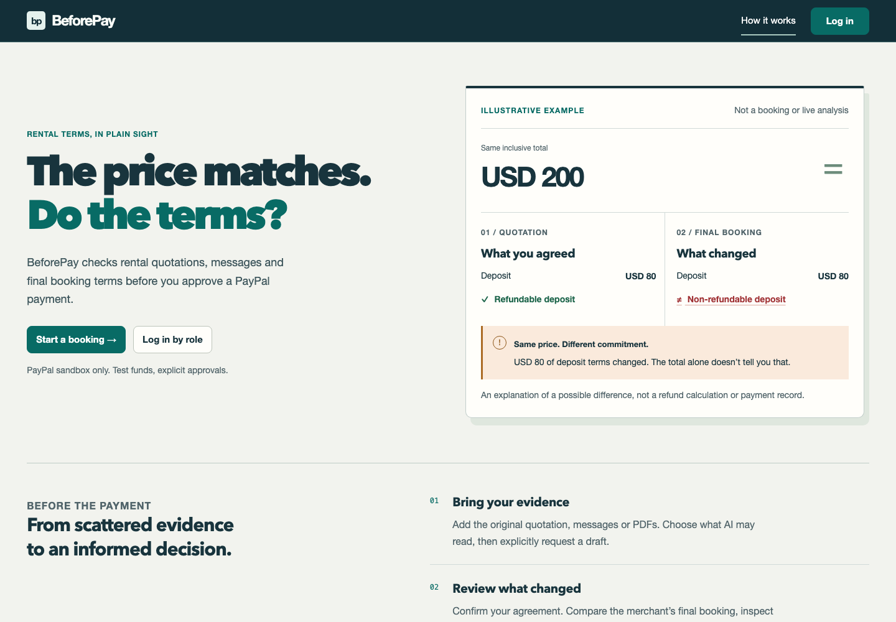

# BeforePay

**Know what you’re agreeing to, before you pay.**

BeforePay helps camera and audiovisual rental customers compare an agreed quotation
and supporting messages with a merchant’s final booking. It keeps original evidence,
changed terms, cancellation consequences and explicit approvals together before
PayPal **sandbox** checkout.

The same USD 200 total can hide a material change: a refundable USD 80 deposit
becomes non-refundable. BeforePay compares the commitments, not just the price.



*Existing product capture; synthetic example, not a booking, live analysis or
payment record. [More screens](docs/screenshots/beforepay-workspace-themes/index.md).*

## Demo availability and walkthrough

**Hosted sandbox walkthrough user-verified on 7 November 2026.** Booking
**Camera kit- test 1** completed a **USD 200** sandbox capture; its receipt persisted
after refresh and links agreement **v2**, merchant proposal **v2**, saved comparison,
checkout approval and both approved cancellation rules. This is manual hosted
verification, separate from mocked tests. The frontend judge URL is not recorded
here; obtain it from the organiser or run locally using the instructions below.
See [hosted evidence and setup](docs/hosted-sandbox-payments.md).

Buyer and Merchant are **prototype views—not authenticated accounts**. Both use
the same session-owned booking and saved versions; switching does not approve or
change anything.

| Step | Workspace | Walkthrough |
| --- | --- | --- |
| 1 | Buyer | **Start a booking**, enter Buyer demo credentials and create a synthetic booking. Continue to **Sources & draft**. |
| 2 | Buyer | Paste quotation/messages or upload a text-based PDF. Select saved sources and explicitly **Generate AI draft** when local Gemini is configured. |
| 3 | Buyer | Review terms beside evidence, acknowledge sources, save any corrections with reasons, then separately confirm the exact agreement. |
| 4 | Merchant | Read the confirmed baseline and save an independent final proposal. A changed deposit policy must not overwrite buyer terms. |
| 5 | Buyer → Merchant | Explicitly compare saved versions. Request **Suggest clarification** beside a discrepancy; switch views to reply against that saved question. |
| 6 | Merchant → Buyer | Correct the proposal and run a fresh comparison. **Review correction** and record review only when backend conditions pass; this is not checkout approval. |
| 7 | Merchant / Buyer | Explicitly **Check policy consistency**. Prepare and separately approve source-bound cancellation rules in each relevant view; preview a cancellation date/time. |
| 8 | Buyer | Inspect checkout blockers and separately approve the exact checkout bundle. Local sandbox checkout or explicitly opted-in hosted sandbox checkout can create/capture an order and issue a verified receipt. Public payments default off; see [controlled sandbox setup](docs/hosted-sandbox-payments.md). |

Opening screens, loading samples or switching views never starts AI, comparisons,
approvals or payments. Unconfigured actions stay blocked; no fabricated fallback
results appear. Without Gemini, a fresh booking supports session/booking/evidence
intake but cannot complete AI drafting.

See [booking entry](docs/booking-entry.md), [workspace handoffs](docs/buyer-merchant-workspaces.md)
and the [historical demo outline](docs/demo-readiness.md). That outline inventories
older local records; it is not a seed or a guaranteed current-session walkthrough.

## Architecture

```mermaid
flowchart TB
    Browser["React · TypeScript · Vite · Tailwind CSS<br/>Buyer / Merchant prototype views"]
    Proxy["Same-origin /api<br/>Local Vite proxy or prepared Vercel rewrite"]
    API["FastAPI modular monolith<br/>Session ownership · CSRF · version and payment guards"]
    Services["Evidence · agreements · comparison · clarification history<br/>Policy consistency · Python cancellation calculations"]
    DB[("PostgreSQL<br/>Immutable versions, approvals and receipts<br/>Session hashes · admission ledger · templates")]
    Gemini["Gemini via official Google GenAI SDK<br/>Explicit requests · validated structured output"]
    PayPal["PayPal sandbox via HTTPX<br/>Explicit local checkout / reconciliation"]
    Webhook["Signed sandbox webhooks<br/>Controlled local setup only"]
    Browser --> Proxy --> API --> Services
    Services --> DB
    Services -. "local opt-in; hosted AI off" .-> Gemini
    Services -. "public sandbox opt-in; otherwise denied" .-> PayPal
    PayPal -.-> Webhook --> API
```



One frontend, one synchronous FastAPI/SQLAlchemy backend and one PostgreSQL
database. PyMuPDF extracts PDF text/pages; Alembic applies explicit migrations.
No agent framework, worker queue or automatic background capture is used. Public
resource/AI admission accounting is durable in PostgreSQL across backend instances.
[Implementation plan](docs/implementation-plan.md).

## Gemini, PayPal and APIMatic contributions

### Gemini: propose and compare with cited support

The official `google-genai` Python SDK handles explicit draft extraction, policy
meaning comparison, clarification suggestions, cancellation-rule proposals and
deposit/cancellation consistency checks. Default configured model is
`gemini-3.5-flash-lite`; credentials/model settings stay backend-only.

Python validates structured output, exact quotations, source/page or saved-term
references and current version bindings. Python compares amounts/dates and
calculates money; Gemini cannot approve terms or calculate refunds. Source text
is untrusted data, never authority to change system instructions. Missing or
unsupported evidence stays explicit. Calls use one attempt, with no automatic
retries, paid fallback or model switching.

**Evaluation limit:** the preserved six-case synthetic pilot used the earlier
comparison prompt. `cmp-08` expected `needs_clarification` but returned `differs`,
with valid quotations. Both statuses block checkout: a classification failure,
not a false match. The subsequent prompt-v2 distinction between explicit conflict
and undefined discretion has only mocked verification—no live rerun or demonstrated
model-quality improvement. The small synthetic dataset is not general accuracy
evidence. [Pilot report](docs/policy-pilot-v2-2026-11-04.md) and
[prompt update/limitations](docs/policy-comparison-commitments.md).

### PayPal: verified sandbox captures and historical receipts

Local sandbox checkout binds separate approval to the exact confirmed agreement,
merchant proposal, current matching comparison, approved consistent rules and
server-derived amount. Stable create/capture keys and persisted capture intent
support duplicate protection and explicit uncertain-result reconciliation.

Only a verified **COMPLETED capture** establishes payment. Buyer approval, browser
callbacks, order creation or webhook event text alone cannot do so. An immutable,
app-issued sandbox receipt preserves captured amount, provider references and exact
approved context. Itemisation appears only if present in the captured snapshot;
current terms never reconstruct historical charges. Copy/print controls are provided,
with payment history outside the receipt.

Historical local sandbox capture/refresh persistence was user-verified. A separate
read-only audit supports recorded verified-path webhook processing and one receipt;
the receipt predates that webhook, so **live browser-interruption recovery was not
demonstrated**. Resend was user-reported without independent per-delivery evidence.
These records are separate from mocked browser receipts and are not imported into
public sessions. [Sandbox guide](docs/paypal-sandbox.md), [webhook design](docs/paypal-webhooks.md)
and [delivery evidence limits](docs/paypal-webhook-verification-2026-11-02.md).

**Public mode defaults:** SDK/client configuration, order creation, capture and
provider reconciliation are denied server-side. An explicit [hosted sandbox
opt-in](docs/hosted-sandbox-payments.md) adds durable attempt limits and requires
separately authorised runtime payment grants, applied on 7 November 2026. Hosted
webhooks stay disabled. No live-money mode or refund execution exists.

For a new sandbox test, use a **Personal sandbox buyer account**, separate from
the Business sandbox seller associated with the REST app. Obtain its login
privately in PayPal Developer Dashboard's Sandbox Accounts or from the organiser;
enter it only in the PayPal sandbox popup. BeforePay demo-role credentials are
not PayPal credentials. Never publish buyer passwords or use real account/card
details. [Step-by-step buyer setup](docs/hosted-sandbox-payments.md#sandbox-buyer-walkthrough).

The hosted walkthrough also exposed **two AI refund-allocation errors**, corrected
manually before separate buyer/merchant rule approvals. The later prompt/schema
fix has offline verification, not demonstrated live model-quality improvement.
Intermittent **`public_setup_required`** errors cleared on refresh; their causes
remain unresolved despite added sanitised diagnostics. A successful capture does
not erase either limitation. [Manual observations](docs/demo.md#user-reported-hosted-walkthrough--2026-11-07).

### APIMatic: development guidance

The APIMatic PayPal Context Plugin supplied Python integration, getting-started,
error-handling and testing guidance: contract planning, local duplicate claims,
idempotency, unknown-outcome handling, safe errors and mocked boundary tests.

The running integration uses the existing fixed-sandbox **HTTPX REST adapter** and
PayPal verification endpoint. No APIMatic SDK or MCP operation performs checkout,
webhook verification or reconciliation. The documented SDK surface did not provide
webhook verification/registration. APIMatic contributed development guidance, not
a hosted webhook service or independent transaction proof.
[Detailed attribution](docs/paypal-webhooks.md#installed-apimatic-paypal-context-plugin-guidance).

## Product modules

| Module | Implemented behaviour |
| --- | --- |
| Bookings/workspaces | Session-owned rental lists, role-specific task overviews, saved-state next actions and explicit prototype view switching. |
| Sources/AI drafts | Text/PDF intake, selected-source generation, exact source/page citations, missing/conflicting terms and immutable unapproved drafts. [Guide](docs/backend-drafts.md). |
| Agreement review | Grouped terms, adjacent evidence, individual correction reasons, source acknowledgements and separate save/confirm steps. [Guide](docs/customer-review.md). |
| Merchant proposals/comparison | Independent immutable proposals; differences-first terms, Python numeric/date checks and cited policy judgments. Equal totals never imply equal terms. [Guide](docs/booking-comparison.md). |
| Clarification questions | Explicit advisory questions, explanation and supporting saved terms, bound to exact comparison/versions. [Guide](docs/clarification-suggestions.md). |
| Merchant replies | Append-only responses: **Merchant response—not verified resolution**. They never amend terms or remove blockers. [Guide](docs/merchant-replies.md). |
| Correction history | Buyer reviews original discrepancy, reply, newer proposal and fresh matching comparison. Backend requires unchanged baseline and current unambiguous bindings. **Correction reviewed for these versions—not checkout approval**. [Guide](docs/clarification-corrections.md). |
| Policy consistency | Explicit latest-proposal deposit/cancellation check: potential contradiction, needs clarification or no contradiction found, with exact clauses. Current conflict/uncertainty blocks definitive merchant previews and checkout. Clean findings grant no approval. [Guide](docs/policy-consistency.md). |
| Cancellation previews | Manual or AI-proposed source-bound rules, editing and separate human approval; Python Decimal/timezone-aware calculations. Narrow pre-pickup USD model. Preview does not cancel/refund. [Guide](docs/cancellation-preview.md). |
| Checkout/receipt | Separate exact-context approval, local or explicitly enabled hosted sandbox capture, durable public attempt caps, uncertain-payment handling and immutable agreement-linked receipt/history. Public execution defaults off. |

Evidence/version changes make dependent results stale. Historical questions,
replies, correction reviews and receipts preserve their original context. Blocker
links lead to the relevant saved review; navigation is never approval.

## Repository structure

```text
BeforePay/
├── frontend/
│   ├── src/              Buyer/Merchant UI, API/session client, receipt and evidence
│   ├── tests/            Synthetic browser journeys and fixtures
│   └── vercel.json       Static frontend and same-origin API rewrite
├── backend/
│   ├── app/              FastAPI modules, settings and synchronous services
│   ├── alembic/          Explicit migrations and database protections
│   ├── scripts/          Template setup, diagnostics and restricted webhook proxy
│   ├── evaluations/      Frozen policy cases, opt-in runners and pilot evidence
│   ├── tests/            Mocked-provider and disposable-PostgreSQL checks
│   ├── uv.lock           Locked Python dependencies
│   └── vercel.json       Prepared FastAPI hosting configuration
├── scripts/              Non-secret Vercel rewrite preparation
├── docs/                 Setup/features, verification records and screenshots
├── compose.yaml          Loopback-only local PostgreSQL 17
└── AGENTS.md             Implementation and safety rules
```

Some package names, API service identifiers and database/migration symbols retain
`contextkey` for compatibility. Display branding is BeforePay.

## Prerequisites

- Git; Node.js satisfying `^20.19.0 || >=22.12.0`, with npm. Node 22.x is the
  prepared Vercel choice; local `.nvmrc` retains tested Node 20.20.2.
- Python **3.14.x** (`>=3.14,<3.15`) and `uv`; `.python-version` selects 3.14
  without requiring a particular patch release.
- Docker Engine/Desktop with Compose, or existing PostgreSQL. Compose uses 17;
  dedicated Neon preparation was verified on 18.
- Chrome/Chromium remote debugging for optional mocked browser suites.

Provider credentials are unnecessary for installation, booking/evidence intake,
manual review of existing drafts or mocked tests. Fresh AI drafting requires
explicit local Gemini configuration. Use synthetic evidence, not customer documents.

## Local setup and run

These commands target **local development**, not Neon. Run from repository root
unless stated otherwise. Review/backup an existing database before upgrading;
session isolation does not adopt old unowned bookings. Never overwrite existing
configuration or restore local records into the public database.

### 1. Clone and configure

```sh
git clone https://github.com/Ishmeet482/BeforePay.git
cd BeforePay
# Optional: if nvm is installed, use this repository's .nvmrc.
nvm install
nvm use

# Preserve existing files; inspect existing settings if already configured.
cp -n .env.example .env
cp -n backend/.env.example backend/.env
cp -n frontend/.env.example frontend/.env
```

Root `.env` supplies Docker database name/user/password/port. Backend `DATABASE_URL`
must match, using `postgresql+psycopg`. Example credentials are local placeholders,
never shared-hosting credentials.

In **backend/.env**, explicitly configure plain-HTTP loopback development:

```dotenv
PUBLIC_DEMO_MODE=false
DEMO_COOKIE_SECURE=false
DEMO_ALLOWED_ORIGINS=["http://127.0.0.1:5173","http://localhost:5173"]
PAYPAL_SANDBOX_ENABLED=false
```

`DEMO_COOKIE_SECURE=false` is permitted only with loopback HTTP configuration;
HTTPS/public hosting must use `true`. The example defaults to secure cookies, so
make this local opt-in before demo entry. Keep provider credentials empty until
you explicitly choose their local actions. Never put secrets in `VITE_*` variables.

### 2. Start PostgreSQL

Start Docker, then:

```sh
docker compose config --quiet
docker compose up -d --wait db
```

Database binds to **127.0.0.1:5433**; container port is 5432. Named-volume data
persists. If the host port changes, update root `POSTGRES_PORT` and backend
`DATABASE_URL`. Initialisation variables affect a new volume only; changing `.env`
does not reset an existing role or database.

Alternatively, skip Docker and create an empty local database as a PostgreSQL admin:

```sh
createuser --pwprompt contextkey
createdb --owner=contextkey contextkey
```

Set backend `DATABASE_URL` privately to that database; URL-encode special characters
and use TLS remotely. BeforePay does not create database roles at startup.

### 3. Install, migrate and start backend

```sh
cd backend
uv sync --frozen
uv run --frozen alembic upgrade head
uv run --frozen alembic current
# Expected repository head: 0015_demo_templates
uv run --frozen uvicorn app.main:app --reload --host 127.0.0.1 --port 8000
```

Launch here because settings read `.env` relative to the working directory.
Migrations run explicitly, never during startup or hosting builds. Migration 0013
adds nullable ownership without assigning legacy records: old bookings/receipts
are preserved but inaccessible to new demo sessions.

### 4. Start frontend in another terminal

```sh
cd frontend
npm ci
npm run dev
```

Open **http://127.0.0.1:5173**. Vite proxies `/api` to port 8000; change server-side
`API_PROXY_TARGET` in `frontend/.env` and restart Vite if necessary. The static build
does not include this development proxy.

| Local endpoint | Purpose |
| --- | --- |
| `http://127.0.0.1:8000/docs` | FastAPI contracts; booking APIs still require session/CSRF checks. |
| `http://127.0.0.1:8000/api/health/live` | Process liveness. |
| `http://127.0.0.1:8000/api/health/ready` | Local database connectivity; public mode additionally validates schema, marker/templates and protections. |
| `http://127.0.0.1:5173/api/health/live` | Frontend proxy connectivity. |

Stop API/frontend with Ctrl-C. `docker compose stop db` preserves database data;
do not remove the volume to restart the app.

### Optional local provider setup

- **Gemini:** set backend-only `GEMINI_API_KEY` from an appropriate Free Tier
  project and retain/review `GEMINI_MODEL`; confirm current account quota/billing
  before any manual request. Restart backend, then explicitly generate from
  selected synthetic sources. [Configuration/validation](docs/backend-drafts.md).
- **PayPal sandbox:** separately configure `PAYPAL_ENVIRONMENT=sandbox`,
  `PAYPAL_SANDBOX_ENABLED=true`, `PAYPAL_SANDBOX_CLIENT_ID`,
  `PAYPAL_SANDBOX_CLIENT_SECRET` and `PAYPAL_SANDBOX_MERCHANT_ID` in the backend.
  `PAYPAL_SANDBOX_WEBHOOK_ID` is only for separately registered, controlled
  sandbox webhook testing. This is optional and distinct from public hosting.
  [Explicit sandbox setup](docs/paypal-sandbox.md#required-backend-settings).

## Demo identities and session isolation

| Prototype view | Username | Public demo password |
| --- | --- | --- |
| Buyer | `buyer.demo` | `BuyerDemo123!` |
| Merchant | `merchant.demo` | `MerchantDemo123!` |

**Demo login—no real authentication. Use demo credentials only.** Passwords are
validated locally, never sent to the API or stored. The selected view is retained
for the tab; it grants no additional backend permissions.

Explicit entry obtains a random server-issued session cookie. Only token hashes
are stored; default absolute expiry is 30 days. Cookies are HttpOnly, host-only,
SameSite=Lax and Secure on HTTPS. Backend ownership checks protect booking lists,
children, evidence and direct API access; mutations require exact Origin and
applicable session-bound CSRF checks. Responses are private/no-store.

Buyer/Merchant switching shares one session and saved versions. Same-origin tabs
share cookies; the persistent cookie also survives normal browser restarts in the
same profile/domain. Choose a demo role again if the tab's role label is gone;
valid cookie reuse keeps saved bookings and does not extend expiry. Use independent
browser contexts to demonstrate isolation. Sign-out
revokes access; a new session cannot recover old bookings. No real-user
authentication, authenticated merchant role or account recovery is implemented.
Unsaved fields are retained during normal navigation or require a discard warning.
[Session contract/limits](docs/demo-sessions.md).

Existing sessions keep their stored expiry; changing configuration only affects
new sessions. Cleared cookies, private browsing, different domains and explicit
sign-out can end access earlier. No countdown, automatic renewal or expired-booking
adoption is implemented.

## Synthetic data

An empty local database has **no seeded booking, AI result, approval or receipt**.
UI samples only fill forms; saves, comparisons and approvals remain explicit.
Browser fixtures and screenshot receipts are synthetic, not payment proof.

Dedicated Neon setup contains migration/infrastructure rows, one public-demo marker
and two version-1 authored sources:

- **SYNTHETIC · Camera rental quotation** — `camera-quotation`.
- **SYNTHETIC · Included items message** — `camera-message`.

They describe one camera, two batteries, USD 120 rental plus USD 80 deposit and an
inclusive USD 200 total, with explicit UTC dates and cancellation clauses.
They are authored examples, not merchant communications or model output.
An active session can read `/api/demo-templates`; no template-picker UI or automatic
import is implemented. Copy text into source intake and explicitly save.

Owner-only setup, **for an explicitly designated synthetic database**:

```sh
# From backend/, with dedicated owner DATABASE_URL exported securely, not local .env.
uv run --frozen python -m scripts.setup_demo \
  --database-name beforepay_demo_2026 \
  --acknowledge-dedicated-synthetic-db
```

Do not accidentally target development. Setup refuses unexpected identity/schema,
existing application data or conflicting templates. The authorised Neon run and
identical second run are recorded in the [hosting guide](docs/hosting-preparation.md#using-templates-without-inventing-saved-history).

## Tests and checks

Automated provider responses are mocked; tests do not establish live AI accuracy
or payment success. Backend integration tests create/migrate/drop disposable,
randomly named PostgreSQL databases. The local role needs `CREATEDB`; Compose’s
default role has it. Never run the suite with hosted runtime/owner URLs exported.
Tests use public local defaults without reading developer `.env` files. Actual
database failures remain failures, not mocked integration successes.

```sh
cd backend
uv run --frozen pytest -q
uv run --frozen ruff check .
uv run --frozen ruff format --check .
```

```sh
cd frontend
npm run typecheck
npm run build
```

Build includes TypeScript checking. For all mocked browser feature suites, start
the isolated QA server from repository root:

```sh
npm --prefix frontend run dev:qa
```

Launch separate Chrome/Chromium in another terminal. Replace `CHROME_EXECUTABLE`
with its installed executable; use a disposable profile:

```sh
CHROME_EXECUTABLE --headless=new --disable-gpu --no-first-run \
  --no-default-browser-check --remote-debugging-port=9228 \
  --user-data-dir="${TMPDIR:-/tmp}/beforepay-browser-qa" about:blank
```

Then, from repository root:

```sh
CDP_URL=http://127.0.0.1:9228 FRONTEND_URL=http://127.0.0.1:5187 \
  npm --prefix frontend run test:browser:all
```

QA has no backend proxy or environment-file loading. Suites inject synthetic
responses, block provider origins and use a fresh tab each; do not substitute the
ordinary dev server. Coverage includes discrepancy → reply → correction → fresh
comparison → separate rule/checkout approvals, blocked/uncertain states, responsive
layouts and receipt printing. [Browser details](docs/blocker-navigation.md#isolated-browser-verification).

Frozen dataset validation and an **unmeasured** call plan, with no provider calls:

```sh
cd backend
uv run --frozen --offline python -m evaluations.policy_eval
```

The 20 cases include two local missing-input checks, excluded from model-performance
denominators. Full evaluation would require 18 separately authorised requests;
only the recorded six-case pilot has run. [Dataset/scoring/opt-in controls](docs/policy-evaluation.md).

## Hosted architecture and deployment status

Prepared architecture uses **two Vercel projects from this same repository**:

| Project | Root | Prepared settings |
| --- | --- | --- |
| Frontend | `frontend` | Vite; `npm ci`; `npm run build`; output `dist`; Node 22.x. |
| Backend | `backend` | FastAPI `app/main.py`; `uv sync --frozen --no-dev`; Python 3.14; 90-second function. |

Neon setup includes migration head `0015_demo_templates`, owner/runtime separation,
narrow grants, immutable protections and idempotent template setup. The later
runtime payment grants were verified with rolled-back SQL probes. The user then
reported a hosted sandbox capture and receipt persistence; this is distinct from
both database grant checks and automated mocks. It does not certify every hosting,
isolation, quota or browser failure path, or an automatic deployment pipeline.

Frontend uses relative `/api`; the committed rewrite targets
`https://before-pay-three.vercel.app/api/:path*`. This is the backend, not the judge
frontend URL. To deliberately change its destination after choosing another host:

```sh
python3 scripts/prepare_vercel.py --backend-origin https://YOUR-BACKEND-HOST
```

This edits non-secret configuration only, without deploying. Deployment order is
backend, readiness verification, then frontend with corrected rewrite.
`DEMO_ALLOWED_ORIGINS` must contain exact frontend HTTPS origins, never wildcard
preview hosts. Preserve cookies, Origin, CSRF and no-cache headers through `/api`.

| Backend configuration | Hosted policy |
| --- | --- |
| `DATABASE_URL` | Backend secret: pooled TLS runtime connection to dedicated database; never owner credentials. |
| `PUBLIC_DEMO_DATABASE` | Exact dedicated database name. |
| `PUBLIC_DEMO_MODE`, `DEMO_COOKIE_SECURE` | `true`. |
| `DEMO_ALLOWED_ORIGINS` | JSON array of actual trusted frontend HTTPS origins. |
| `DEMO_AI_CALLS_PER_DAY`, `DEMO_AI_TOKENS_PER_DAY`, `DEMO_AI_TOKENS_PER_MINUTE` | Default `0`; explicitly budgeted enablement retains atomic reservations, concurrency and quota controls. Current dashboard values are not audited here. |
| `GEMINI_API_KEY` | Backend-only; configured privately for explicitly budgeted AI. |
| `PUBLIC_SANDBOX_PAYMENTS_ENABLED`, `PAYPAL_SANDBOX_ENABLED` | Default `false`; both must be explicitly `true` for hosted sandbox checkout, with complete same-app sandbox credentials and runtime grants. |
| `PAYPAL_ENVIRONMENT`, PayPal credential variables | Only `sandbox`; client ID, secret and merchant ID configured privately in backend. Only client ID is exposed to SDK. |
| `DEMO_PAYMENT_ATTEMPTS_GLOBAL`, `DEMO_PAYMENT_ATTEMPTS_PER_SESSION` | Default `20` / `1`, durable all-time new-attempt caps, not daily resets. |
| `PUBLIC_WEBHOOKS_ENABLED` | `false`; hosted webhooks remain disabled. |

Frontend needs no database/provider secrets or `VITE_*` configuration. Retain
conservative session/resource caps and bounded connection pools. Runtime cannot
modify templates/migration metadata or delete history. Explicit payment grants
allow only append operations and named operational attempt updates; immutable
history and binding protections remain. Future privileges need explicit review,
not blanket grants.

Before release, verify actual account limits, build/bundle/runtime acceptance,
pooler/TLS, domains/deployment protection, cookie/CSRF/cache isolation, uploads and
edge limits. AI defaults off unless explicitly budgeted; hosted manual extraction
was reported separately from automated checks. No retries or paid fallback are
enabled. [Hosting/operator runbook](docs/hosting-preparation.md),
[permission audit](docs/neon-runtime-permissions.md), [durable controls](docs/public-demo-controls.md).

## Safeguards and limitations

- **Human decisions:** AI findings remain advisory. Separate exact-version
  agreement, rule and checkout approvals are required; merchant replies and
  correction reviews cannot grant them.
- **Version integrity:** sources and immutable versions persist. Corrections need
  reasons; saved context is rechecked after inference. Missing, stale,
  contradictory or unsupported terms cannot become matching or definite by guess.
- **Money:** Python Decimal/timezone-aware calculations; inclusive total is never
  an extra charge. Cancellation is a narrow pre-pickup USD preview, not a refund
  action or a general legal-policy engine.
- **Payment:** backend guards, booking locks, stable keys and uncertain-outcome
  checks control capture. Approval alone is never paid. Receipts are historical
  sandbox capture records, not tax invoices or guarantees of current settlement.
  Refunds, reversals and disputes are unsupported.
- **Isolation:** backend-enforced expiring workspace ownership, with provisional
  roles/reviewer labels. Database runtime credentials are trusted backend secrets;
  session isolation is not PostgreSQL RLS or authenticated identity.
- **Resource safety:** durable global/session caps cover entries, writes,
  evidence/uploads and AI reservations. Crashes/quota failures fail closed; no
  retry/fallback resets allowances. Hosted flood/cold-start behaviour is unverified.
- **Privacy:** use synthetic documents. Keep credentials, local environments,
  uploads, dumps and provider payloads outside Git. Safe diagnostics omit raw
  sources/provider responses; review provider data policies before sensitive input.

BeforePay is a rental-agreement prototype, not a legal guarantee or production
rental/payment service. [Contributor safeguards](AGENTS.md).

## Verification evidence

Recorded checkpoints below were not rerun merely to edit this README.

| Evidence | Scope and limits |
| --- | --- |
| Automated checks | Hosting checkpoint: **630 backend tests passed**, plus later focused checks; frontend build/typecheck and Ruff passed. Providers mocked, PostgreSQL disposable. No live AI/payment certification. [Record](docs/hosting-preparation.md#verification-and-account-dependent-gates). |
| Rendered journeys | Synthetic desktop/tablet/mobile flows, blocked states, history and print specimens demonstrate UI behaviour, not provider transactions. [Gallery](docs/screenshots/beforepay-workspace-themes/index.md), [connected journey](docs/blocker-navigation.md). |
| Live extraction/manual workflows | Cited draft persistence was recorded through the service; user-reported clarification/reply/correction and consistency observations are separately labelled. [Extraction](docs/backend-drafts.md), [replies](docs/merchant-replies.md), [correction review](docs/clarification-corrections.md), [consistency](docs/policy-consistency.md). |
| User-reported refund boundary | Approved rules produced USD 200 refund exactly 48 hours before pickup; one minute later USD 80 refunded / USD 120 retained. Not independently rerun during documentation. [Report](docs/cancellation-preview.md#user-reported-live-proposal-and-manual-preview-verification--2026-11-02). |
| Historical sandbox payment/webhook | Manual capture/refresh persistence and verified-path event/single-receipt audit; no live browser-loss recovery demonstration or independent resend proof. [Payment](docs/paypal-sandbox.md#successful-manual-capture-and-refresh-persistence--2026-10-31), [audit](docs/paypal-webhook-verification-2026-11-02.md). |
| Hosted sandbox capture — 7 November 2026 | User verified **Camera kit- test 1**, **USD 200**, receipt after refresh, agreement **v2** / proposal **v2**, saved comparison, checkout approval and both approved cancellation rules. Manual observation, not an automated test or a new independent provider audit. No hosted webhook/interruption-recovery claim. [Report](docs/hosted-sandbox-payments.md#user-verified-hosted-sandbox-capture--7-november-2026). |
| Six-case AI pilot | Three cases per task, valid literal citations in all six, one comparison uncertainty-label failure. Uncertainty handling: comparison **0/1**, consistency **1/1**. Small synthetic pilot, not general accuracy; prompt v2 live-unverified. [Expected/actual results and denominators](docs/policy-pilot-v2-2026-11-04.md). |
| Dedicated Neon setup | Real owner/runtime connections, migration head, permission denials, 20 protection triggers, two templates and idempotency verified. Later payment grants passed runtime-authenticated rollback probes; all 25 table fingerprints/counts were preserved. Setup/probes seeded no persistent sessions/bookings/payments; later user-created hosted records are separate. [Record](docs/neon-runtime-permissions.md). |
