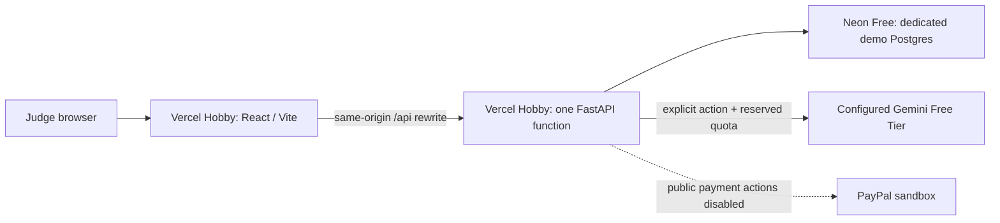

# Public hackathon deployment assessment — 2026-11-05

**Phase 3 prepared:** [hosting configuration and operator runbook](hosting-preparation.md)
now covers Vercel rewrites, strict public configuration/database readiness,
bounded pools, Linux wheel/native checks and idempotent synthetic template setup.
Migration 0015 remains unapplied to development. No deployment/provisioning;
account entitlements, actual hosted routing/cookies/build and quotas still need
authorised staging. Original assessment below remains historical context.

**Implementation update:** anonymous session/ownership isolation, CSRF/origin and
private cache headers are now implemented locally. See [Phase 1 scope, verification
and remaining gates](demo-sessions.md). Migration 0013 is unapplied to development.
The original assessment below describes the pre-implementation baseline; resource
budgets, synthetic hosting setup and public payment denial remain outstanding.

**Phase 2 update:** [durable public controls](public-demo-controls.md) now implement
AI/resource admission and public payment-execution denial. Migration 0014 remains
unapplied to development. AI defaults to zero public allowance. User-required signed
webhook handling remains an explicit exception; hosting/edge controls, synthetic
templates and staging verification are still outstanding. The original assessment
below remains historical planning context.

**Not safe to publish the current backend unchanged.** A zero-cost, functional
hackathon demo is plausible after backend isolation, shared resource budgets and
deployment wiring. This is an assessment, not an implemented or tested deployment.
Inspected source/configuration and public official hosting documentation only;
no accounts, credentials, database records or provider APIs were accessed. No
services provisioned, migrations/tests run, API exposed or deployment performed.

## Smallest practical architecture

Two Vercel projects from the same repository: `frontend/` for the static build,
`backend/` for the existing modular monolith. One managed database; no Redis,
worker, object store, microservice split, public tunnel or always-on local machine.
Serving both builds from one Vercel project is possible integration work, but
separate roots avoid adding a new frontend-serving layer to FastAPI.

Current Vercel docs support Python **3.14**, `pyproject.toml`/`uv.lock`, and
FastAPI `app/main.py`. FastAPI becomes one function; the existing synchronous
SQLAlchemy endpoints need no async rewrite. These are documented capabilities,
not proof this dependency bundle builds successfully on Linux.
[Python runtime](https://vercel.com/docs/functions/runtimes/python),
[FastAPI deployment](https://vercel.com/docs/frameworks/backend/fastapi).

Frontend proposal: existing `npm ci`/`npm run build`, output `dist`, supported
Node 22 release compatible with `package.json`. Backend: Python 3.14, frozen lock,
native FastAPI function with an explicit duration above the SDK's 60-second timeout
(for example 90 seconds). Verify deployment settings before adopting these values.
Do not put the backend into a short-lived Node proxy function.

## What code currently provides — and lacks

| Area | Inspected implementation | Public-deployment consequence |
| --- | --- | --- |
| Deployment | Local `compose.yaml` starts PostgreSQL only. No Vercel manifests, backend Dockerfile or hosted build configuration found. Vite proxy exists only in `server.proxy`. | Static frontend alone cannot reach `/api`; deployment routing/build setup is missing. |
| Runtime | Python `>=3.14,<3.15`; FastAPI, synchronous SQLAlchemy/psycopg, PyMuPDF, HTTPX and GenAI. Explicit Alembic migrations. | Preserve runtime/lock. Validate Linux wheels, function bundle and timeouts; migrate only a new demo database later. |
| Database | Global booking list; `require_booking`/`lock_booking` check existence, not ownership. Nested records bind booking IDs. | Knowing a UUID is not permission. All reads, mutations, histories, approvals and receipt access need session ownership. |
| Demo identity | `frontend/src/demo-session.ts` stores only a Buyer/Merchant label in browser sessionStorage; public passwords checked locally. | No server authentication, session isolation or role permission exists. Hiding buttons/CORS cannot fix this. |
| Evidence/storage | Pasted text and extracted PDF text/pages persist in PostgreSQL. Original PDF bytes are not retained; multipart/PyMuPDF processing uses temporary memory/files. | No durable file volume or object store needed for existing functionality. Never promise original-PDF download. Do not upload development files/documents. |
| Upload resources | 5 MiB PDF, 100 pages, 100,000 extracted characters; middleware buffers the bounded body; per-process PDF lock. | Native Vercel functions have a smaller payload ceiling. Public uploads need lower caps and admission controls. |
| CORS/session headers | No CORS, session, CSRF or trusted-host middleware in `app/main.py`. `review-api.ts` fetches relative `/api`; no auth header. | Add backend-enforced session and request-origin policy; same-origin proxy is proposed, not configured. |
| AI | Explicit extraction, policy comparison, suggestions, consistency and rule-proposal endpoints; bounded prompts, safe errors, one attempt, version rechecks. | No shared request/token budget, session allowance, global concurrency limit or admission ledger. Public callers can repeatedly spend project quota. |
| Payments | Fixed sandbox adapter, exact-version eligibility, idempotent attempts, uncertain-outcome reconciliation and immutable linked receipts. | Strong financial-state checks, but no caller authorization. A stranger can create their own eligible data or act on another booking if given backend access. |
| Webhook | Signature verification before processing, immutable event deduplication, fixed provider verification endpoint. | No session cookie belongs here, but public submissions can trigger verification traffic if sandbox credentials are enabled. Public mode should deny this route unless an organiser enables the controlled integration. |

Reviewed `backend/app/main.py`, `core/config.py`, `core/database.py`,
`bookings/router.py`, evidence schemas/parser, AI routers/providers, payment
router/provider/webhook code, `frontend/vite.config.ts`, `review-api.ts` and
`demo-session.ts`. No secret files were inspected. Backend configuration currently
accepts local development defaults; public mode must fail closed if required
deployment/session/budget settings are missing.

## Backend isolation: first release blocker

Implement a short-lived **server-issued demo workspace**, not pretend real-user
authentication. Suggested initial lifetime: 45 minutes, one or two bookings.

1. A throttled `POST /api/demo-sessions` creates a high-entropy opaque token; store
   its hash, expiry and budgets in PostgreSQL. Return it as a host-only
   `HttpOnly; Secure; SameSite=Lax` cookie through the frontend's same-origin `/api`
   proxy. Do not use the public role/password or a caller-supplied workspace ID
   as authorization. Expired/unknown sessions fail closed.
2. Bind each new booking to that server-side session. Scope listing and every
   booking/nested-record lookup before reading or writing, including evidence,
   comparisons, questions, replies, reviews, rules, approvals, attempts and receipts.
   Foreign record IDs return no access. Keep all existing exact-version guards.
3. Buyer/Merchant remain clearly labelled prototype views of the judge's **same
   isolated workspace**. Switching performs no approval. Session ownership is real
   access control; it is not verified buyer/merchant identity or separation of two
   authenticated people. Do not claim otherwise.
4. Add same-origin mutation checks and a session-bound CSRF header/token. No
   wildcard credentialed CORS. Restrict allowed production/staging origins exactly;
   do not trust all `*.vercel.app`. The directly reachable backend must enforce the
   same ownership/budgets; Origin/CORS and a proxy URL are not authentication.
5. Set private/no-store headers on session/data responses and disable external
   rewrite caching. Verify cookie forwarding, omitted cookie Domain, CSRF and
   cache separation between two browsers. Preview deployments must not inherit
   public AI/payment privileges or production data automatically.

Proposed additive session/ownership/budget migrations are implementation work,
**not present and not applied**. Do not retrofit ownership by exporting the current
development database into public hosting.

## Synthetic data and persistence

Use a **new, empty, dedicated demo database**, not the current bookings or receipts.
Seed each workspace with synthetic quotation/message text and a small synthetic PDF;
judges should perform actual review, explicit generation, proposal revision and
confirmation through existing services. Never manufacture AI drafts, comparison
results, approval rows or successful payment records as if freshly produced.

Initially restrict PDF uploads to supplied synthetic templates or a tightly capped
synthetic-upload path: proposed **3 MiB**, fewer pages and lower text limits. Preserve
actual extraction and evidence links. Custom pasted text should be bounded and
labelled synthetic-only; a notice alone cannot guarantee users submit no personal
data. Keep originals out of logs. An original-file download feature would require
separate storage work; it is not needed for the existing extracted-text interface.

Use the provider's TLS connection string adapted to `postgresql+psycopg`, a pooled
runtime endpoint, conservative per-instance SQLAlchemy connections, and a direct
endpoint for operator-run Alembic migrations. Verify psycopg prepared-statement
behaviour with the selected pooler and actual JSONB/locking/immutable triggers.
Runtime must not have schema-changing privileges; do not migrate on every request.

Session expiry does **not** reclaim immutable history. Cap sessions, bookings,
sources and versions globally as well as per workspace. Keep receipt/version
UPDATE/DELETE protections. Any event-end reset of this dedicated synthetic database
requires an explicit operator procedure; do not add casual cascading deletes that
bypass immutable records.

## AI: actual functionality with a hard zero-cost boundary

Cover **all five AI entry points**: extraction; comparisons that require policy
inference; clarification; consistency; cancellation-rule proposal. A frontend spinner
or per-process counter does not limit parallel requests or new sessions.

- Reserve an attempted-call allowance atomically in PostgreSQL **before** invoking
  the provider. Commit it separately from the booking transaction released around
  inference; otherwise rollback can erase consumed quota. Count failures, abandoned
  requests and stale-result rejections. Retain existing post-inference version checks.
  Bind an admission/request ID to the session, action and exact input fingerprints;
  replaying an in-flight request must not launch another inference. Budgeting is
  durable across instances, not an in-memory semaphore.
- Initial proposal: at most **6 attempted calls per session**, one global in-flight
  model request, a short cooldown, and capped session creation/IP bursts. Set the
  global daily allowance to the **smaller of an operator ceiling and verified free
  project quota minus reserve**, with RPM/TPM constraints too. With no verified
  allowance, live AI budget is zero. New cookies/IPs cannot bypass the global cap.
- Bound public input/output more tightly where needed; reserve worst-case token
  allowance and retain safe usage metadata. Do not silently truncate evidence.
  Keep explicit buttons, configured model, one attempt, no paid/model fallback.
  On quota/auth errors, trip a global circuit breaker and expose a clear temporary
  unavailable state. No automatic AI retry, including browser timeout retries.
- Judges may keep editing/reviewing and use deterministic comparisons/manual rules
  when quota is unavailable. Show unavailable status honestly; never substitute
  a fixture response under a live-AI label. This reduces AI availability, not the
  reality of the remaining backend functionality.

The documented Gemini 3.5 Flash-Lite standard tier lists free input/output, but
actual access and quotas depend on the project. Limits are per project, not API
key; check the existing Free Tier project in AI Studio before enabling public AI.
Do not upgrade billing. [Pricing](https://aistudio.google.com/docs/pricing#gemini-3.5-flash-lite),
[rate limits](https://aistudio.google.com/docs/rate-limits).

## Payments: deny arbitrary public actions

**Recommended initial public mode: real application workflow, payment execution
disabled server-side.** Do not install PayPal merchant secrets on that public
backend. Add a fail-closed public-demo policy that denies order creation, capture,
capture/create retries, reconciliation and webhook/provider verification even if
someone accidentally enables the ordinary sandbox flag. Hide/disable the SDK action
with the exact explanation. Existing version guards and immutable receipts remain.

Judges can still exercise actual exact-version checkout readiness/approval if
session-scoped, but cannot make a provider payment. For the final scene, offer an
explicitly labelled **recorded sandbox receipt example** separately from the judge's
unpaid booking. A curated example needs separate approval for public-safe publication;
do not copy current developer transactions into sessions or insert mocked receipts
into the payment ledger. If using a visual fixture instead, label it **mocked receipt**.

If judging requires a **fresh interactive sandbox capture**, the initial mode does
not satisfy that extra requirement. Add a later organiser-controlled, short-lived
payment capability bound to one session, booking, approval fingerprint, sandbox
merchant and capped amount, plus a global attempt limit. Never grant it merely
because a browser says Buyer. Preserve stable attempt keys and uncertain-result
reconciliation; a one-time grant must not break legitimate same-attempt recovery.
Use separate sandbox buyer accounts, never publish shared merchant credentials.
The signed webhook route would be the only non-session exception, with provider
verification abuse limits and existing event deduplication intact. No real mode,
refund, settlement or production-payment claim.

## Hosting limits checked against official docs

These are public documentation checks on **2026-11-05**, not account entitlement,
region, packaging, routing or deployment verification. Recheck before provisioning.

| Service | Current documented constraint | Decision / remaining verification |
| --- | --- | --- |
| Vercel Hobby | Personal/non-commercial use; 100 GB data transfer, 1 million invocations and 4 active CPU-hours included monthly. | Confirm hackathon/team use is eligible and both projects stay on Free; no paid trial or automatic upgrade. Account limits are shared, not a public-traffic guarantee. [Hobby plan](https://vercel.com/docs/plans/hobby) |
| Vercel Python/FastAPI | Python 3.14 supported; ordinary Python bundle 500 MB. | Validate frozen Linux install including PyMuPDF; exclude `.venv`, secrets, tests and local evaluation/result artifacts. Avoid depending on larger-bundle beta. [Runtime](https://vercel.com/docs/functions/runtimes/python), [FastAPI](https://vercel.com/docs/frameworks/backend/fastapi) |
| Vercel function limits | With Fluid Compute, Hobby maximum/default duration 300 seconds, memory 2 GB; request/response payload limit 4.5 MB. | **Current 5 MiB PDF capability does not fit.** Lower both client/server public limits or select a different upload path. Verify effective duration/configuration; do not assume resource limits prevent abuse. [Limits](https://vercel.com/docs/functions/limitations) |
| External `/api` rewrite | Vercel supports external origins; proxy timeout 120 seconds. | Route to the separate backend project with `/api` preserved; no caching. Verify multipart, cookie/CSRF forwarding and direct-backend denial. [Rewrites](https://vercel.com/docs/routing/rewrites), [proxy timeout](https://vercel.com/docs/limits#proxied-request-timeout) |
| Neon Free | $0 without time limit/card; currently 1 GB storage and 100 CU-hours per project/month, scale-to-zero after five idle minutes. | Confirm actual account offer/regions, connection/egress ceilings and pooled TLS access. Small session caps; avoid continuous DB wake-up polling. No paid plan fallback. [Pricing](https://neon.com/pricing) |
| Render Free alternative | 750 shared instance-hours/month; sleeps after 15 idle minutes, wake-up about one minute; ephemeral disk; free PostgreSQL expires after 30 days. No free persistent disk/shell. | Fallback API host only if Vercel native bundle is unsuitable, still use Neon. Cold start plus 60-second AI may exceed browser/proxy timeouts; add explicit warm/readiness handling. Outbound traffic/build limits also apply. [Free limits](https://render.com/docs/free) |

Do not repeat older Neon 0.5 GB/50 CU-hour figures or assume Python 3.14 is unsupported
on Vercel: current official pages differ. A $0 demo is conditional on eligibility,
remaining quotas and **accepting throttling/suspension**, not guaranteed always-on
service. Unbounded internet availability at zero cost is not a defensible promise.

## Phased plan and release gates

| Phase | Concrete work | Gate before proceeding |
| --- | --- | --- |
| 1. Local isolation first | Implement server sessions, owner-scoped access, CSRF/origin/no-store policy, synthetic templates and global resource limits. Default public AI/payment disabled. | Two independent sessions cannot read/mutate each other's nested resources; direct API bypass and public-password/role tampering do not grant access. No developer data exposed. |
| 2. Local functional judge journey | Exercise actual intake/extraction boundary, review, proposal change at unchanged USD 200, comparison, clarification/reply, correction review, Python preview and checkout readiness. Use mocked providers for safety tests only. | Version races, explicit approvals, expired sessions, quota races/failures and payment denial work. Unavailable AI is honest, not simulated success. Existing receipt guards remain. |
| 3. Packaging/account decision | Prepare two Vercel project configs, rewrite, public upload cap, dependency bundle and pooled DB settings; inspect Free eligibility/limits and choose quotas. | Compatible Linux build; plan remains $0; no credentials in frontend or artifacts; migration/runtime roles separated. No provisioning without approval. |
| 4. Authorised staging only | Provision isolated Free database/projects, apply migrations there, set backend-only secrets, validate TLS/cookies/cache isolation and cold paths. Authorise only a small bounded set of real AI calls. | Judges reach public frontend and actually persist isolated data; no unscoped route or arbitrary payment path; observed deployment behaviour meets limits. This phase is not authorised now. |
| 5. Release and monitor | Publish only after gates, show demo/AI/payment provenance, usage availability and reset/kill-switch procedure. Optional controlled sandbox capture is separately scoped. | Explicit publishing approval, hard budgets/circuit breakers and a truthful judge-facing feature list. |

**Concrete blockers today:** no server isolation/ownership; no global AI/admission
budget; no public payment execution policy; no production routing/configuration;
5 MiB/function payload mismatch; unverified Linux bundle, pooled database and
cookie/cache behaviour; no dedicated synthetic hosted data set or verified account
allowances. Existing local manual/provider success and mocked regressions do not
remove those deployment blockers.
