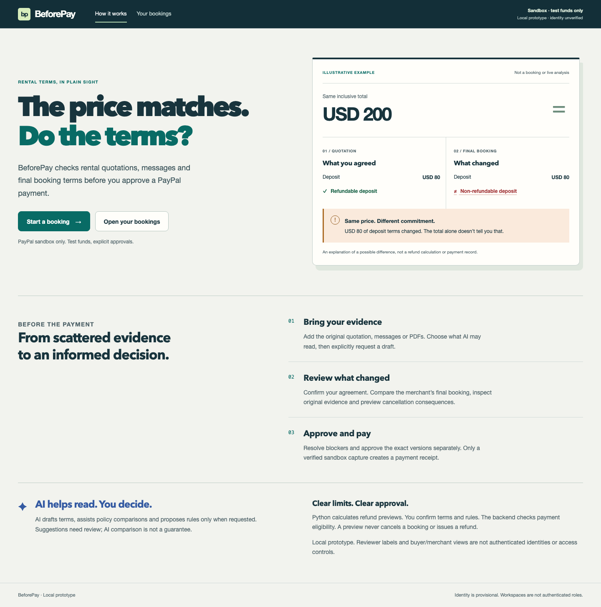
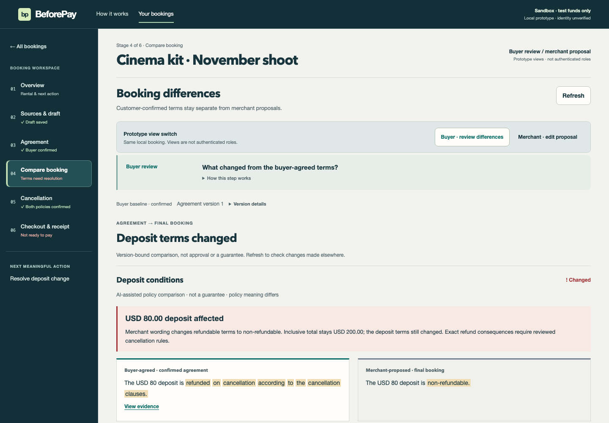
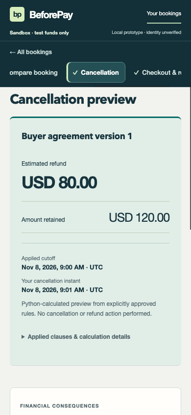
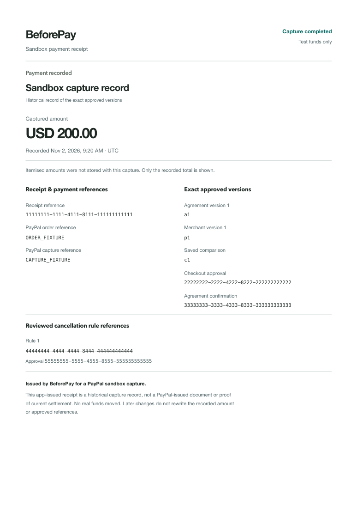

# BeforePay product screenshot gallery — 2026-11-03

All content is synthetic. These are rendered React screenshots from isolated
mock API journeys, not live AI analysis or real payment records. Desktop 1440×1000,
tablet 834×1112, mobile 390×844. Entry captures show its full page; task captures
show the relevant viewport and continue below. Refund results are focused/scrolled
into view after an explicit preview.

[Changes, checks and limitations](../../product-redesign-2026-11-03.md).

| Screen | Desktop | Tablet | Mobile |
| --- | --- | --- | --- |
| Product entry | [desktop](entry-desktop.png) | [tablet](entry-tablet.png) | [mobile](entry-mobile.png) |
| Bookings | [desktop](bookings-desktop.png) | [tablet](bookings-tablet.png) | [mobile](bookings-mobile.png) |
| Overview | [desktop](overview-desktop.png) | [tablet](overview-tablet.png) | [mobile](overview-mobile.png) |
| Original sources and AI draft | [desktop](sources-desktop.png) | [tablet](sources-tablet.png) | [mobile](sources-mobile.png) |
| Buyer agreement | [desktop](agreement-desktop.png) | [tablet](agreement-tablet.png) | [mobile](agreement-mobile.png) |
| Buyer differences | [desktop](comparison-desktop.png) | [tablet](comparison-tablet.png) | [mobile](comparison-mobile.png) |
| Merchant proposal | [desktop](merchant-desktop.png) | [tablet](merchant-tablet.png) | [mobile](merchant-mobile.png) |
| Cancellation result | [desktop](cancellation-desktop.png) | [tablet](cancellation-tablet.png) | [mobile](cancellation-mobile.png) |
| Checkout approval | [desktop](checkout-desktop.png) | [tablet](checkout-tablet.png) | [mobile](checkout-mobile.png) |
| Recorded sandbox receipt | [desktop](receipt-desktop.png) | [tablet](receipt-tablet.png) | [mobile](receipt-mobile.png) |
| Missing rule approval | [desktop](missing-rules-desktop.png) | [tablet](missing-rules-tablet.png) | [mobile](missing-rules-mobile.png) |
| Uncertain payment | [desktop](uncertain-desktop.png) | [tablet](uncertain-tablet.png) | [mobile](uncertain-mobile.png) |
| Original evidence drawer | [desktop](evidence-desktop.png) | [tablet](evidence-tablet.png) | [mobile](evidence-mobile.png) |

Additional views: [empty bookings](empty-desktop.png),
[new booking form](create-booking-desktop.png),
[source validation error](source-error-desktop.png).

Print: [one-page A4 synthetic PDF](sandbox-receipt-synthetic.pdf) ·
[rendered print output](receipt-print.png).

[Browser gallery with every screen](index.html).

## Product entry

## Changes in context

## Mobile refund result

## Printable historical receipt

