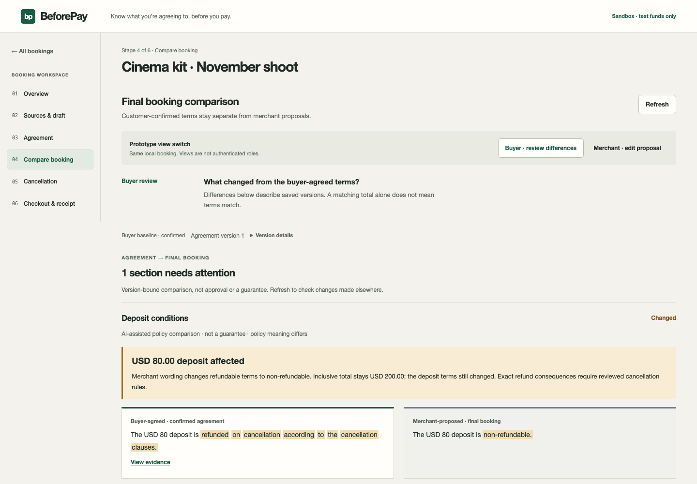
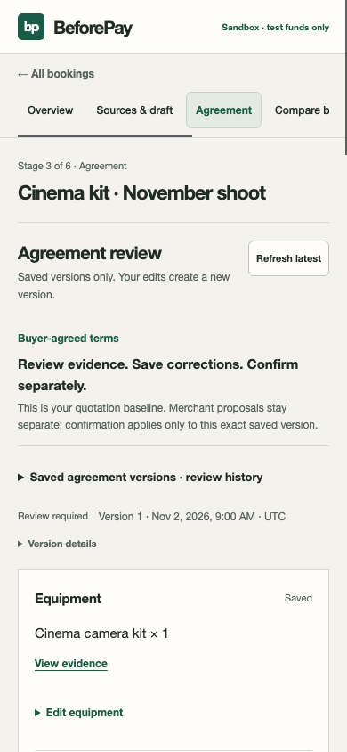
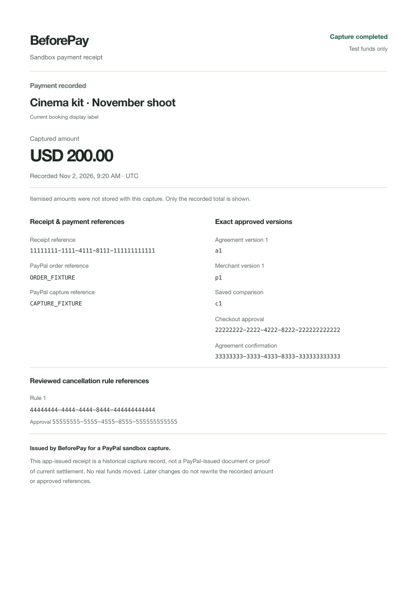

# BeforePay synthetic screenshot gallery

All data is synthetic. These screenshots demonstrate interface states and mocked
journeys; they are not live AI, provider or payment evidence. Desktop 1440×1000,
tablet 834×1112, mobile 390×844. Screenshots are viewport captures; longer pages
continue below the captured area.

[Design, safeguards and verification](../../beforepay-ux-overhaul.md).

| Screen | Desktop | Tablet | Mobile |
| --- | --- | --- | --- |
| Bookings | [desktop](bookings-desktop.png) | — | — |
| Overview | [desktop](overview-desktop.png) | [tablet](overview-tablet.png) | [mobile](overview-mobile.png) |
| Sources and draft | [desktop](sources-desktop.png) | [tablet](sources-tablet.png) | [mobile](sources-mobile.png) |
| Buyer agreement | [desktop](agreement-desktop.png) | [tablet](agreement-tablet.png) | [mobile](agreement-mobile.png) |
| Buyer differences | [desktop](comparison-desktop.png) | [tablet](comparison-tablet.png) | [mobile](comparison-mobile.png) |
| Merchant proposal workspace | [desktop](merchant-desktop.png) | [tablet](merchant-tablet.png) | [mobile](merchant-mobile.png) |
| Cancellation calculator | [desktop](cancellation-desktop.png) | [tablet](cancellation-tablet.png) | [mobile](cancellation-mobile.png) |
| Checkout approval | [desktop](checkout-desktop.png) | [tablet](checkout-tablet.png) | [mobile](checkout-mobile.png) |
| Completed sandbox receipt | [desktop](receipt-desktop.png) | [tablet](receipt-tablet.png) | [mobile](receipt-mobile.png) |
| Missing reviewed rules | [desktop](missing-rules-desktop.png) | [tablet](missing-rules-tablet.png) | [mobile](missing-rules-mobile.png) |
| Uncertain payment | [desktop](uncertain-desktop.png) | [tablet](uncertain-tablet.png) | [mobile](uncertain-mobile.png) |
| Evidence drawer | [desktop](evidence-desktop.png) | [tablet](evidence-tablet.png) | [mobile](evidence-mobile.png) |

Additional states: [empty bookings](empty-desktop.png),
[source validation error](source-error-desktop.png).

Print: [one-page synthetic PDF](sandbox-receipt-synthetic.pdf) ·
[rendered print output](receipt-print.png).

Browser gallery: [all screens](index.html).

## Differences first

## Mobile agreement

## Receipt print output

